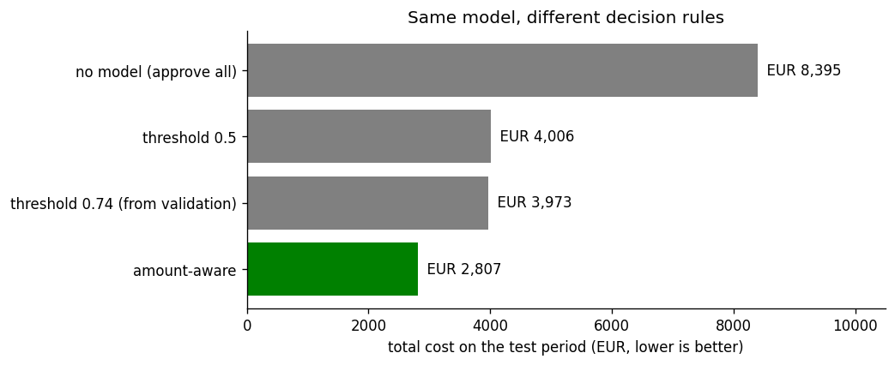
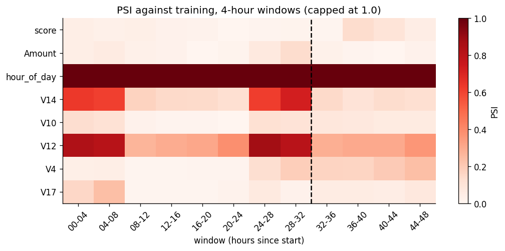

# Fraud detection: from a score to a decision in euros

A card-fraud model, trained and judged on **real payments split by time**,
that decides in **euros** instead of accuracy. Two notebooks: one trains the
model and turns its scores into decisions, the other checks whether the
model would still be seeing the world it learned from.

Data: 284,807 real card payments by European cardholders over two days
(Worldline and ULB). 492 of them are fraud.



## Key finding

The same model costs very different amounts depending on how you turn its
score into a decision. Reviewing a payment costs about €5. Missing a fraud
costs its full amount. So we review a payment when

> **fraud probability × amount > €5**

On the last 8 hours of data, which the model never saw, that rule costs
**€2,807**. A standard 0.5 threshold costs **€4,006**, and approving
everything costs **€8,395**. The amount-aware rule catches *fewer* frauds
(25 against 58) but *more fraud money* (€5,954 against €4,724). It spends
reviews on large payments and lets through €1 frauds that cost less than a
review.

**The honest caveat:** the test period holds only 76 frauds. In a bootstrap
the amount-aware rule beats the 0.5 threshold 92% of the time, but the 95%
interval for the saving (−€63 to €3,707) touches zero, and on the
validation period the rules were nearly tied. It is at least as good, needs
no tuning, and pulls ahead when large frauds show up.

## Results

All numbers are on the test period (hours 40 to 48), which was used once, at
the end.

| | |
|---|---|
| Test PR-AUC, plain XGBoost | **0.80** (logistic baseline 0.71) |
| Class weights / SMOTE | No better at ranking (0.79 / 0.80), and they distort probabilities |
| Precision in the top 100 | **0.60**: 60 of the 76 test frauds sit in the model's 100 most suspicious payments (the best possible is 0.76) |
| Cost: amount-aware rule | **€2,807** |
| Cost: 0.5 threshold / best validation threshold / no model | €4,006 / €3,973 / €8,395 |
| SMOTE scores fed into the amount-aware rule | €8,918, *worse than no model* |
| Share of fraud money caught on unseen hours | 62% to 71% |

A light tuning check, scored in time order inside the training part, tried
12 settings of tree depth, learning rate and tree count. All landed between
0.783 and 0.811 PR-AUC, while the folds themselves differ by about 0.08. The
best setting beat the defaults by 0.009, so the defaults stayed.

## What's inside

| Part | What it does |
|---|---|
| [`01_train_and_decide.ipynb`](notebooks/01_train_and_decide.ipynb) | Why this dataset, cleaning, time-based split, logistic baseline, XGBoost with and without class weights and SMOTE, a light tuning check, probability checks, cost-based decision rules, bootstrap uncertainty, a comparison with random and stratified splits. Saves the model. |
| [`02_drift_monitoring.ipynb`](notebooks/02_drift_monitoring.ipynb) | PSI explained and tracked over 12 windows, the hour-of-day false alarm and how to avoid it, real performance per window once labels arrive. |
| [`src/`](src/) | Small helper functions both notebooks use: the features and decision rule (`features.py`) and the drift measure (`monitoring.py`). The notebooks show how each one is built. |
| [`artifacts/`](artifacts/) | The trained model (`model.json`) and its card (`model_card.json`: inputs, review cost, split hours, test results, drift reference). |
| [`docs/images/`](docs/images/) | The charts used in this README. |

The notebooks are written to be read without running: every step says what
it does and why, shows the data, and says what the result means.

## How to run

```bash
pip install -r requirements.txt
# download data/creditcard.csv: see data/README.md
cd notebooks && jupyter notebook   # run 01, then 02
```

Notebook 02 reads the model that notebook 01 saves. A trained copy is
already in `artifacts/`.

## Design decisions

- **Split by time, never at random.** Train on hours 0 to 32, choose on 32
  to 40, test once on 40 to 48. Fraud arrives in bursts, and fraud patterns
  change, so a random split puts near-copies of test frauds in training
  (7.7% of test frauds in one shuffled run, against none in the time
  split). Shuffled and stratified splits also score higher on PR-AUC (0.84
  and 0.83 against 0.80), partly because their test parts hold more fraud;
  ROC-AUC is the same (0.98) for all three. The fraud rate itself also
  differs between the periods (0.21% in training, about 0.1% later), mostly
  because training holds both nights and the later periods are daytime
  only.
- **No resampling.** Class weights and SMOTE did not rank better, and they
  inflate the probabilities: SMOTE's average prediction is about nine times
  the real fraud rate. The decision rule multiplies probability by amount,
  so honest probabilities matter.
- **Hour of day, not raw time.** Raw `Time` only counts up, so every future
  payment would lie outside the training range. Hour of day repeats.
- **Duplicates removed, with a reason.** 1,081 rows are identical in all 31
  columns, down to the second. They are the same payment logged twice.
- **Helpers shown, then shared.** The notebooks show how each helper
  function is built, and `src/` holds the same code so both notebooks use
  one definition.
- **No pickle.** The model is saved in XGBoost's own JSON format.

## Monitoring

Chargebacks arrive weeks late, so on any given day we can't measure
accuracy. Instead we watch the inputs and the model's score with the
Population Stability Index (PSI).



Short windows compared with all of training raise **false alarms** for
anything that follows the clock: `hour_of_day`, and here also `V12` and
`V14`. Comparing each window with **the same hours the day before** removes
them and leaves `V4`, the one input that really shifted on day two. The
model's score stayed stable across all 12 windows.

## Limitations

- **Two days of data** and 76 test frauds, so the results carry wide
  uncertainty (shown with a bootstrap in notebook 01).
- **Validation and test are daytime only.** Training holds both nights, but
  the later periods do not, so the results say little about night-time
  performance.
- **Anonymised features.** `V1` to `V28` are PCA components, and there is no
  card or customer ID, so behavioural features (such as payments per card
  in the last hour) are not possible with this dataset.
- **The €5 review cost is an assumption.** Change `REVIEW_COST_EUR` in
  `src/features.py` and rerun.
- **Probabilities are overconfident between 1% and 50%.** Few payments land
  there (about 110 of 62,000 on validation), but a calibration step is the
  obvious next improvement.
- The saved model is trained on the training period only, exactly as
  evaluated. Refitting on all data before use is a natural next step, as is
  serving the model behind a small web API.

## Project layout

```
.
├── notebooks/
│   ├── 01_train_and_decide.ipynb
│   └── 02_drift_monitoring.ipynb
├── src/
│   ├── features.py        # features + decision rule
│   └── monitoring.py      # PSI drift functions
├── artifacts/
│   ├── model.json         # trained XGBoost model
│   └── model_card.json    # features, results, drift reference
├── docs/images/           # charts used in this README
├── data/README.md         # how to get the data (not committed)
├── DECISIONS.md           # the choices made, in order
├── requirements.txt
└── LICENSE
```

## Data and licence

Credit Card Fraud Detection dataset, Worldline and the Machine Learning
Group of ULB, released under ODbL 1.0. See [`data/README.md`](data/README.md).
The data is not redistributed here. Code: MIT, see [LICENSE](LICENSE).
